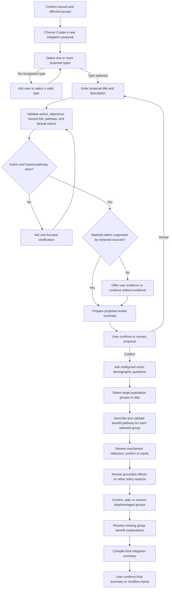

# Mitigation measure options: step-by-step flows

This guide documents the two choices shown after the user reviews the selected hazard and affected groups:

1. **Create a new mitigation proposal** (`new_policy`)
2. **Propose adaptations in the existing policy** (`existing_policy`)

Both options reuse the selected country, region, sector, hazard, policy context, and affected-group context. They diverge at the proposal-design stage and later converge on the shared mitigation-measure review, summary, and evaluation steps. Exact prompts can vary when source data or optional evidence is unavailable.

## 1. Create a new mitigation proposal

### Steps

1. **Choose the new-proposal option.** The session is marked `new_policy` and enters mitigation proposal setup.
2. **Choose one or more proposal types.** The available types are Regulation, Economic incentives, Public services, and Information/education. At least one recognized type must be selected to proceed.
3. **Enter the proposal title and description.** The proposal describes the new action. It is not required to be an amendment to an existing policy.
4. **Run the preliminary proposal validation.** The system gathers the selected context, proposal, selected-policy objectives and mechanisms, sector objective, and relevant policy and knowledge-base passages. It checks the action, its objective links, hazard relevance, mitigation pathway, and material factual support.
5. **Clarify the action or hazard pathway if needed.** If the action or its hazard-reduction pathway is materially unclear, the app asks one focused question and validates again with the clarification. Unclear policy-objective or sector-objective alignment is recorded as an advisory finding rather than a reason to block confirmation.
6. **Address evidence support if needed.** When the review cannot support material factual claims from retrieved knowledge, the user may supply evidence or continue without it. Supplied evidence is checked for relevance. A proposal does not need to already exist in a source corpus.
7. **Review and confirm or revise.** The app shows a concise proposal review and notes uncertain policy/sector links, hazard pathway, or factual support. The user can revise the proposal before proceeding.
8. **Answer the socio-demographic target-population questions.** The app presents its configured population questions (for example age, gender, income, education, disability/long-term condition, tenancy, and location). The user selects one or more relevant options per question, or skips questions. Selections become the proposal's target groups.
9. **Describe the benefit pathway for each selected group.** For each group, explain what the measure does and how that benefits the group. A group can be skipped. The app checks clarity, group-specific benefit, and the causal link to hazard reduction; it notes policy or sector objective links where stated. It does not require the user to repeat context labels when the connection is clear from the explanation. Unclear pathways are clarified, and unsupported factual claims can trigger an optional evidence prompt.
10. **Review the mechanism reflection.** The system prepares how the proposal changes the selected mechanism and reduces the hazard, using the proposal, hazard, mechanism, policy linkage, target groups, and group pathways. The user confirms or clarifies it.
11. **Review possible effects on other policy aspects.** The app searches grounded policy/hazard records for unintended effects. For each supported effect, the user says whether the measure could cause it; a concern can require a clarifying explanation or additional mitigation, while disagreement requires a reason. If no distinct grounded effect is found, this review is skipped.
12. **Review the disadvantaged groups and their benefit explanations.** The app displays groups and grounded benefit pathways. If it cannot identify groups or pathways, it asks the user to add groups or explain how the measure benefits each group. The user can confirm, add, or remove groups.
13. **Review the final summary.** The app compiles the proposal, measure, mechanism, reflection, evidence status, policy-effect decisions, groups, and available group evidence. The user confirms the final summary or returns to revise inputs.

### Proposal validation rules

- The title and description should convey a specific, understandable policy action, intended beneficiaries, and expected outcome. Implementation-level detail is not required unless its absence prevents understanding.
- A plausible direct or indirect link to at least one supplied objective of the selected policy is assessed; objectives and mechanisms must not be invented.
- A plausible, concrete contribution to at least one supplied sectoral objective is assessed; the proposal need not address every objective.
- The proposal's primary substantive test is whether its action plausibly reduces the selected hazard's likelihood, severity, exposure, or financial consequences. The validation traces the action back to the hazard; the proposal need not alter a mechanism of the selected policy.
- The proposal is checked against problems explicitly described in the “Policy mechanisms worth considering for mitigation” summary. A clear causal conflict requires revision; an uncertain conflict is surfaced for review.
- The mitigation pathway should explain how the action changes circumstances and why that reduces the hazard. Exact figures or detailed administrative rules are not required.
- New funding, processes, eligibility rules, or protections are allowed. The system must not reject a proposal simply because those provisions are not already in law.
- Material factual claims about existing laws, institutions, funding programmes, or demonstrated outcomes are checked separately against secondary knowledge-base passages. Unsupported facts alone do not make an otherwise clear proposal unclear or irrelevant.
- If supplied, user evidence is checked for relevance. It is not mandatory merely to assess conceptual relevance.

### Flowchart

## 2. Propose adaptations in the existing policy

### Steps

1. **Choose the existing-policy adaptation option.** The session is marked `existing_policy`.
2. **Confirm which policy is being adapted.** If no policy is already selected in context, the app asks the user to select one. The selected policy becomes the anchor for the interview.
3. **Load policy mechanisms and supported adaptation context.** Depending on available records, the app uses matched D4.2 data, passages from linked policy documents, and relevant knowledge-base passages. Suggestions must be grounded in the selected material; the app can say that no supported challenge or adaptation was found.
4. **Describe the policy gap (Question 1).** Explain how a current policy mechanism contributes to the hazard and why the policy response is insufficient, ineffective, or unfair. The answer is checked against the policy and hazard. If supporting passages are absent, the system may ask for evidence; for this first answer, the user can continue without evidence.
5. **Confirm or revise the reflection on the gap.** Where the flow presents a reflection, the user confirms its accuracy or revises the answer.
6. **Propose a concrete adjustment (Question 2).** Describe the specific policy change that addresses the validated gap. The validator checks that it responds to Question 1, mitigates the selected hazard, and connects to a mechanism actually present in the current policy. A proposed future change cannot be treated as a current policy provision.
7. **Select target groups for Question 3.** The app asks the configured socio-demographic questions (for example age, gender, income, education, disability/long-term condition, tenancy, and location). Select one or more relevant groups; selections are collected as the target population.
8. **Explain the policy barrier for the selected groups.** The app asks how the adapted policy should address the barrier faced by the selected population. The answer is checked for a clear target group and policy barrier, and for relevance to the selected policy and hazard. If supporting sources are missing, the app can ask for evidence; the first answer can continue without it.
9. **Describe the benefit pathway for each selected group.** For each group, explain how the proposed adjustment produces a benefit. A group can be skipped. The app checks that the pathway is clear, group-specific, hazard-relevant, connected to the validated policy gap and adjustment, and traceable to a real mechanism in the selected policy. If retrieved support is missing, it may request evidence; the user can continue without evidence.
10. **Review the mechanism reflection.** The system prepares an explanation using the selected hazard and mechanism, policy linkage, validated gap, proposed change, target groups, and group pathways. The user confirms it or clarifies how the adjustment changes the mechanism.
11. **Review possible effects on other policy aspects.** Grounded policy/hazard records may identify unintended effects. The user reviews each one; agreement calls for clarification and an additional mitigation, while disagreement requires a concrete reason. If no distinct supported effects are found, the flow moves on.
12. **Review the disadvantaged groups and benefit explanations.** The app shows target groups and the benefit pathways it has or the user has supplied. Missing group/pathway detail prompts the user to add or clarify it. The user confirms, adds, or removes groups.
13. **Provide optional evidence for newly added groups, if requested.** Evidence is checked for relevance to whether the group benefits from the measure; it can be skipped.
14. **Review the final summary.** The app compiles the policy gap and adjustment together with the mitigation measure, mechanism, reflection, evidence status, policy-effect decisions, groups, and available group evidence. The user confirms the final summary or modifies inputs.

### Adaptation-answer validation rules

- **Policy relevance is required for each accepted answer.** The validator must identify a specific policy link and support it with relevant D4.2 current-policy material or linked policy-document passage. A non-empty selected-policy summary may establish relevance when the model explicitly uses the summary basis, but it is not independent evidence.
- **Question 1:** The claimed gap must fit the selected policy's scope/details and connect the current policy mechanism to the hazard. The insufficiency, ineffectiveness, or unfairness claim must connect to a policy mechanism or documented gap.
- **Question 2:** The adjustment must be concrete, respond to the validated Question 1 answer, mitigate the hazard, and trace to a mechanism that exists in the selected policy. Proposed adjustments in D4.2 are future proposals, not proof of current provisions.
- **Question 3:** A target population and the policy barrier it faces must be identifiable.
- The answer must be clear and relevant; unclear, irrelevant, or contradicted answers trigger a focused clarification rather than being accepted.
- If user evidence is supplied, it must be relevant to the answer. Missing retrieved support can trigger an evidence request; the first question explicitly allows continuing without evidence.
- User-provided text and retrieved passages are treated as data, not instructions. The model must not invent policy facts or evidence.

### Flowchart

```mermaid
flowchart TD
    A[Confirm hazard and affected groups] --> B[Choose Propose adaptations in the existing policy]
    B --> C{Policy already selected?}
    C -->|No| D[Select policy]
    C -->|Yes| E[Use selected policy]
    D --> F[Load supported policy mechanisms, gaps, and adaptation context]
    E --> F
    F --> G[Question 1: describe current policy gap and hazard connection]
    G --> H[Validate policy link, gap, and hazard relevance]
    H --> I{Clear and grounded enough?}
    I -->|No| G
    I -->|Retrieved support missing| J[Request evidence or allow continue without evidence for Q1]
    J --> K[Confirm or revise gap reflection]
    I -->|Yes| K
    K --> L[Question 2: propose concrete policy adjustment]
    L --> M[Check it addresses Q1, reduces hazard, and maps to a current policy mechanism]
    M --> N{Valid link and clear adjustment?}
    N -->|No| L
    N -->|Support missing| O[Request relevant evidence]
    O --> L
    N -->|Yes| P[Question 3: answer configured socio-demographic questions]
    P --> Q[Select target groups]
    Q --> R[Explain the policy barrier for selected groups]
    R --> S[Validate group, barrier, policy link, and answer clarity]
    S --> T{Clear and grounded enough?}
    T -->|No| R
    T -->|Yes| U[Describe benefit pathway for each selected group]
    U --> V[Validate benefit pathway against policy, gap, adjustment, and hazard]
    V --> W{Pathway clear?}
    W -->|No| U
    W -->|Support missing| X[Offer evidence or continue without evidence]
    W -->|Yes| Y[Review mechanism reflection; confirm or clarify]
    X --> Y
    Y --> Z[Review grounded effects on other policy aspects]
    Z --> AA[Confirm, add, or remove disadvantaged groups]
    AA --> AB[Resolve missing group benefit explanations]
    AB --> AC[Compile final mitigation summary]
    AC --> AD[User confirms final summary or modifies inputs]
```

## How the summaries differ

- **New-proposal preliminary review:** an LLM review produces a concise summary and pathway, then the app appends explicit notes for unconfirmed policy/sector links, a pathway needing review, or unsupported/unlinked claims. If the LLM result is unavailable or malformed, the app shows a fallback message asking the user to review the action and hazard-reduction pathway.
- **Shared mitigation creation summary:** the app assembles a structured summary from session data: proposal title/type when present, measure, mechanisms, confirmed mechanism reflection, evidence status, reviewed policy effects, affected groups, and group-evidence status. Source controls point to user/selected inputs or reused knowledge excerpts where available. The user can confirm or revise.
- **Adaptation content:** the validated gap, proposed adjustment, target groups, and any group benefit pathways are passed into the shared mechanism reflection and carried into the later summary context. Policy claims remain grounded in the policy materials gathered for the interview.

## Context shown when choosing existing-policy adaptations

This section explains the context card shown immediately after choosing **Propose adaptations in the existing policy** (the screenshot with headings such as **Policy mechanisms worth considering for mitigation** and **Proposed adaptations for the policy**). It is a collection of selected context plus source-grounded reference sections. The exact document path depends on whether the selected policy has a matching D4.2 factsheet record, is user-added, or has linked policy-document passages.

| Heading in the card | When a matching D4.2 factsheet record is available | When no matching D4.2 factsheet record is available |
| --- | --- | --- |
| **Selected policy** | The selected policy name from the session. D4.2 matching uses the selected policy together with the selected country and sector. | Same: session selection; it is not generated from a factsheet. If no policy is selected, the existing-policy path asks the user to select one first. |
| **Selected hazard** | The selected hazard (or accepted custom hazard) from the session. | Same. |
| **Selected context** | Country, region, and sector from the session, joined for display. | Same. These values are not inferred from a factsheet. |
| **Policy Objectives** | Uses the policy-objectives section already shown in the selected-policy summary, including its source button where present. | Same first choice. If that section is missing, the app falls back to the matched policy-summary reference's **Original Policy Objective** field and its document/page citation. If neither has an objective, it shows “Not stated in the supplied text.” |
| **Policy mechanisms worth considering for mitigation** | The D4.2 reference contributes available fields such as original objectives, policy type, sectoral challenge, existing gaps, proposed adjustment, and proposal description. These are combined with retrieved shared-KB passages. An LLM extracts up to four policy-to-hazard causal mechanisms, each tied to one cited source. D4.2 proposed adjustments are treated as possible future changes, not existing mechanisms. | For non-user policies, linked policy-document chunks (when available) and shared-KB passages are used. If there is no D4.2 match, the app tries linked policy documents and KB; KB retrieval excludes hazard-with-mitigation records and the D4.2 PDF for this section. With no usable sources or no source-backed mechanism, the card says “No grounded mechanism is available.” For user-added policies, the D4.2 match is skipped and linked documents/KB are used. |
| **Proposed adaptations for the policy** | Values from the D4.2 **Proposed Adjustment** and **Description of the Proposal** fields are split into points, deduplicated, and shown with document/source/page citations. | The app first tries the linked policy-document passages. Up to eight passages from linked documents are ranked by overlap with terms from the selected policy name; an LLM can return up to three supported challenges and three adaptations, each tied to a passage/source button. If there is no linked document or no supporting passage, the card states that no supported adaptation was found. For user-added policies, a separate semantic factsheet-inference path may be used first (described below); if it returns nothing, linked policy documents are the fallback. |
| **Challenges to be addressed** | The D4.2 **Sectoral Challenge Addressed** field is shown as deduplicated points with D4.2 source/page citations. If the matching record has no challenge, the card says so. | Uses the same linked-policy-document passage process as proposed adaptations and asks for supported challenges tied to passages. If none is available, it says no supported challenge was found. For user-added policies, inferred same-sector factsheet examples may supply a challenge first; otherwise the linked-document fallback applies. |
| **Disadvantage groups to consider for this mitigation measure** | Taken from `session.socio_demographic_profiles`, which was collected earlier in the hazard/population flow. It is not derived from the D4.2 record. | Same. If no profiles are present, this heading is omitted. |

### Special case: user-added policy with no own factsheet

For a user-added policy, the app does not match its title to a D4.2 record. It can instead search same-country/sector adaptation factsheets and infer examples, but only when it has all of the following:

- selected policy objectives from the policy summary;
- selected policy gaps from that summary or policy-summary reference;
- at least one grounded policy mechanism extracted for the selected policy; and
- candidate adaptations in same-sector factsheet records.

The inference runs through meaning-based filters: similar objectives, then similar gaps, then adaptations linked to the selected policy mechanisms. It returns source-linked examples when supported. It does not invent a factsheet record for the user policy. If the required policy context or a supported match is missing, it falls back to linked policy-document passages; with no linked document, it reports that no matching D4.2 record or linked policy document is available.

### Reading the screenshot's source buttons

- A D4.2 button identifies the D4.2 PDF, source URI, page where available, and the relevant field/point.
- A linked-policy-document button identifies the document, source URI, page where available, passage excerpt, and how that passage was used (challenge or suggested adaptation).
- A mechanism button identifies its supporting document/excerpt and shows the extracted mechanism plus its policy-to-hazard linkage.
- The selected policy, hazard, context, and affected profiles are session selections, so they may have source controls identifying them as selected context rather than citing a factsheet.

The implementation for this card is primarily `app/services/chat_mitigation_steps.py` (`_create_mitigation_measure_step`, `_selected_policy_objectives_for_mitigation`) and `app/services/chat_mitigation_creation_guided.py` (`_existing_policy_mechanisms_reference`, `_existing_policy_adaptation_reference`, `_policy_document_adaptation_reference`, `_inferred_existing_policy_adaptations`). D4.2 field matching is in `app/services/policy_summary_references.py` (`d42_policy_reference`).

## Data used for the “Adopt mitigation measure for my context” card

The screenshot headed **Confirm the mitigation measure** is generated after the user chooses to adopt the suggested measure. The measure, policy description, hazard pathway, and group pathways are generated together from the current session and available source context; the card then displays those outputs and a confirmation choice.

| Card heading | Context used to generate or display it |
| --- | --- |
| **Selected policy** | The selected policy title from the session (`selected_mitigation_policy` or `selected_context_policy`). |
| **Measure text** | Generated by an LLM from the selected policy title and summary, country, region, sector, selected hazard, important proposal concepts, and supplied passages. With a D4.2 match, concepts commonly include the matched challenge, proposed approach, and grounded policy mechanisms. Without a matching D4.2 record, the concepts can come from linked policy-document passages, shared knowledge-base results, or the inferred same-sector factsheet path for a user-added policy. It is expected to propose a concrete measure that fits the policy and reduces the hazard. |
| **What this policy is about** | Generated in the same LLM response using the selected policy summary and retrieved source passages. If the model leaves it empty, the display falls back to the selected policy summary/description; if that is unavailable, it displays “Not available from the selected policy summary.” |
| **How the proposed measure mitigates the selected hazard** | Generated in the same response from the selected hazard and source context. It explains the action-to-hazard pathway. If empty, the card falls back to the generated reason; if that is also empty, it displays “No pathway available.” |
| **Suggested disadvantaged groups benefited** | The considered groups come from the “Disadvantage groups to consider for this mitigation measure” context assembled from the previously selected affected profiles and any other available profile lists. For each group, the LLM is asked for a concrete measure-to-benefit pathway using the measure, selected hazard/policy, policy summary, and source passages. It must not claim benefit just by naming a group. |
| **Uncovered groups / access-barrier notice** | An independent LLM check reviews group-specific pathways and whether the proposed measure introduces access barriers (for example a required fee or mandatory training before participation). When sources exist, an asserted group pathway must cite a supplied source ID. User-provided pathways can be shown as user-provided; if their evidence was skipped they are marked unverified. Groups without an accepted pathway are listed as uncovered, and a possible access barrier can require revision. |

### Source context with and without a D4.2 factsheet

**When a matching D4.2 factsheet exists:** the app uses the matched country/sector/policy D4.2 record for policy fields, challenges, gaps, and proposed-adjustment ideas. It also uses the selected policy summary and retrieves policy-adaptation sources (D4.2 current-policy fields, D4.2 proposal fields, linked policy passages, and shared-KB passages), plus additional group-specific KB passages for considered groups. A proposed adjustment in D4.2 is treated as an idea for change, not a current legal duty. The generated measure may use the proposed approach, but group-benefit and policy claims must still be supported by relevant source context.

**When no matching D4.2 factsheet exists:**

- For a policy with linked policy documents, their selected passages and shared-KB results provide the policy mechanisms, challenges, and possible adaptation context. The generation prompt may draft an adaptation from the selected policy summary/mechanisms even when there is no prewritten D4.2 approach.
- For a user-added policy, the app can infer examples from same-sector/country factsheets only after semantic matching of the selected policy objectives, its gaps, and available policy mechanisms. If no supported match results, linked policy-document passages and shared-KB results remain the fallback.
- If policy summary/concepts and usable source passages are both missing, the app cannot generate a grounded adoption draft and asks the user to write a mitigation measure instead.

The main generation method is `app/services/chat_mitigation_steps.py` (`_adopt_inspired_mitigation_response`); the confirmation card is `_inspired_mitigation_confirmation_response`. The group coverage and barrier check uses source passages selected for the policy and groups. On adoption, the accepted measure and its group pathways are passed into the shared mitigation review flow.

## Main implementation references

- Option selection and routing: `app/services/chat_hazard_steps.py` (`_handle_mitigation_choice`).
- New proposal validation: `app/services/chat_mitigation_steps.py` (`_validate_new_policy_proposal`).
- Existing-policy interview and answer validation: `app/services/chat_mitigation_steps.py` (`_start_policy_adaptation_questions`, `_policy_adaptation_sources`, `_handle_policy_adaptation_answer`).
- Existing-policy grounded adaptation suggestions and policy-document references: `app/services/chat_mitigation_creation_guided.py` (`_existing_policy_adaptation_reference`).
- Shared mitigation summary: `app/services/chat_mitigation_creation_guided.py` (`_guided_summary_step`, `_generate_guided_summary`).
